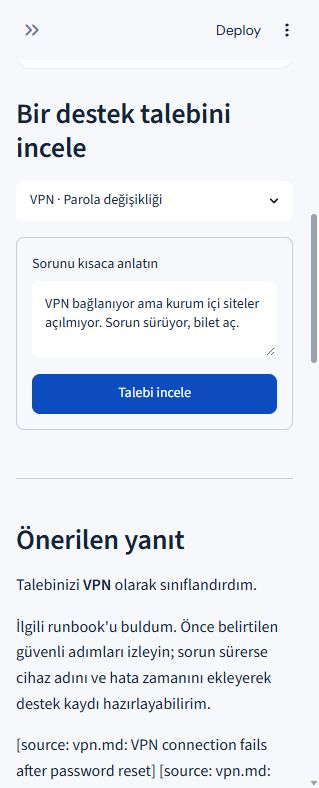
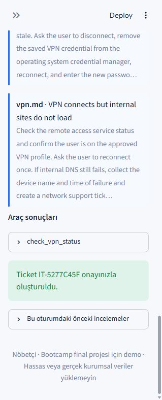
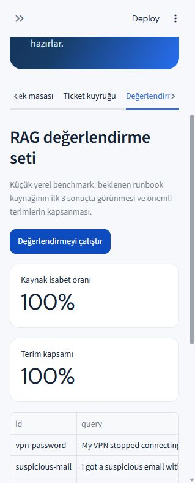

# Nöbetçi — Agentic IT Support Desk

Kurum içi IT taleplerini anlayan, onaylı runbook'larda kanıt arayan, salt okunur teşhis araçlarını çağıran ve gerektiğinde kullanıcı onayıyla destek kaydı açan çok adımlı agentic AI demo uygulaması.

> Eğitim/final proje demosudur. Servis durumu, envanter ve ticket kuyruğu örnek yerel verilerdir. Gerçek kurumsal sistemlere bağlanmaz. Gerçek kullanıcı/parola/kurum verisi yüklemeyin.

## Neler yapıyor?

- **Multi-agent orkestrasyonu:** Triage, Planner, RAG Retriever, Diagnostics, Response ve Safety rolleri ayrı adımlarda çalışır.
- **Planlama:** Ajan sorunu sınıflandırır, çözüm planı ve durma koşulları çıkarır.
- **RAG:** Markdown runbook'ları bölüm/chunk düzeyinde arar. `OPENAI_API_KEY` varsa embedding ve BM25 sinyallerini hibrit sıralar; anahtar yoksa yerel BM25 benzeri retrieval kullanır.
- **Kaynaklı yanıt:** Runbook dosyası ve bölüm adı cevapta gösterilir; bulunan kanıtlar arayüzde incelenebilir.
- **Function/tool calling:** VPN/servis sağlığı ve cihaz envanteri için allowlist'te bulunan salt okunur araçları çalıştırır. API anahtarı yoksa aynı senaryolar yerel demo araçlarıyla denenir.
- **Hafıza:** SQLite oturum hafızası ve yakın konuşmalar; kullanıcı oturum hafızasını arayüzden silebilir.
- **Human-in-the-loop:** Destek kaydı taslak olarak gösterilir, yalnızca kullanıcı onaylarsa yerel ticket kuyruğuna yazılır.
- **Guardrails:** Parola/MFA kodu isteme ve güvenlik korumasını kapatma gibi önerileri durdurur. Dokümanları ve kullanıcı girdisini talimat değil veri kabul eder.
- **Gözlemlenebilirlik:** Agent adımları, kaynaklar, araç çağrıları ve onaylanan kayıtlar için SQLite audit izi.
- **Evaluation:** Dört örnek sorgulu, kaynak isabeti ve anahtar terim kapsamı metrikleri olan mini RAG değerlendirmesi.
- **Hata toleransı:** API/embedding çağrısı başarısızsa uygulama deterministik demo akışına geri döner.

## Ekran görüntüleri

Bu ekran görüntüleri yerel örnek verilerle alınmıştır; talep analizi, onay adımı ve retrieval benchmark'ını gösterir.







## Kurulum

Şirket içi kullanım, teknoloji açıklamaları ve örnek talepler için [KULLANIM_KILAVUZU.md](KULLANIM_KILAVUZU.md) dosyasına bakın.

Python 3.11 veya üzeri önerilir.

```powershell
cd it_support_agent
python -m venv .venv
.venv\Scripts\Activate.ps1
python -m pip install -r requirements.txt
Copy-Item .env.example .env
```

Uygulamayı API anahtarı olmadan demo modunda çalıştırabilirsiniz:

```powershell
streamlit run app.py
```

LLM ve hibrit embedding retrieval için `.env` dosyasında anahtar ve model tanımlayın:

```dotenv
OPENAI_API_KEY=your-key
OPENAI_MODEL=gpt-4.1-mini
```

Ardından `streamlit run app.py` komutunu çalıştırın. Anahtar kaynak koda eklenmez; `.env` Git tarafından yok sayılır. LLM erişimi yoksa veya istek başarısız olursa fallback çalışır. Embedding kullanılamazsa lexical retrieval kullanılmaya devam eder.

## Kullanım

1. **Destek masası** sekmesinde hazır senaryo seçin veya bir talep girin.
2. Triage sınıflandırmasını, planı, RAG kanıtlarını ve araç sonuçlarını inceleyin.
3. Ticket önerildiyse taslağı gözden geçirin; yalnızca gerektiğinde **Onayla ve ticket oluştur** düğmesine basın.
4. **Ticket kuyruğu** ve denetim izinden yerel kayıtları kontrol edin.
5. **Değerlendirme** sekmesinde mini retrieval benchmark'ını çalıştırın.
6. **Bilgi tabanı** sekmesinden Markdown runbook ekleyin. Yalnızca güvenli, gizlilikten arındırılmış içerik kullanın.

## Mimari

```text
Streamlit UI
  └─ SupportOrchestrator
      ├─ Triage Agent (structured JSON)
      ├─ Planner Agent (steps + stop conditions)
      ├─ KnowledgeBase (hybrid dense + lexical RAG, lexical fallback)
      ├─ Diagnostics Agent (bounded allowlisted function calling)
      ├─ Response Agent (evidence-grounded answer + ticket draft)
      ├─ Safety checks
      └─ Human approval → SQLite ticket queue
SQLite: session memory · conversation history · tickets · audit events
```

## Teknolojiler

- Python, Streamlit
- OpenAI API (isteğe bağlı; chat orchestration ve `text-embedding-3-small` embeddings)
- SQLite (hafıza, demo ticket kuyruğu ve audit izi)
- Yerel Markdown/JSON (runbook ve örnek envanter)

## Güvenlik ve kapsam

- Demo araçları yalnızca okur; hesap açma, parola sıfırlama, grup üyeliği değiştirme veya cihaz üzerinde işlem yapmaz.
- Gerçek destek kaydı oluşturulmaz; onaylanan ticket yalnızca yerel SQLite demo kuyruğuna eklenir.
- Kayıtlar ve oturum hafızası yereldir. Hassas veri eklemeyin; `.env` dosyasını paylaşmayın.
- Guardrail'ler örnek korumalardır; üretim ortamı güvenlik denetiminin yerine geçmez.
- `DATABASE_PATH` ve `KNOWLEDGE_DIR` ortam değişkenleriyle veri konumu değiştirilebilir.

## Repository teslim kontrol listesi

- [x] Kaynak kodu ve modüler agent akışı
- [x] Proje amacı, kurulum ve çalıştırma adımları
- [x] Temel teknoloji açıklaması
- [x] Çalışan uygulamadan ekran görüntüleri (`screenshots/`)
- [ ] GitHub'a yükleme ve repository URL'si
